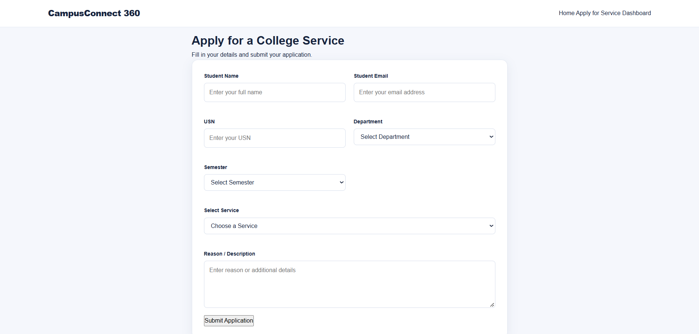
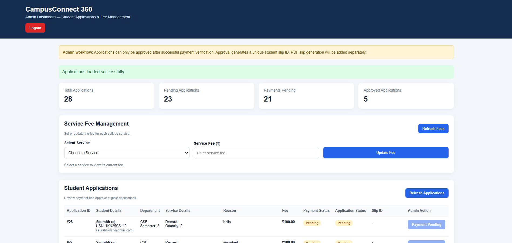

# CampusConnect 360 🎓

**A College Service Management Platform**

CampusConnect 360 is a web-based college service management platform developed to simplify academic and general college services.

It helps students submit service applications online, make payments, and track application status without unnecessary paperwork or repeated visits to the college office.

The platform follows a **hybrid workflow**: eligible routine services can be processed through the system, while applications requiring official verification are handled by the admin.

## 🚀 Features

### 👨‍🎓 Student Features
- Student registration and secure login
- Online application submission
- Academic and general college services
- Application status tracking
- Online payment integration (Razorpay Test Mode)
- Downloadable approval slips in PDF format

### 🛡️ Admin Features
- Secure admin login
- View and manage student applications
- Verify student payments
- Approve eligible paid applications
- Configure service fees
- Generate unique student-wise slip IDs
- Download application slips

## 📚 Available Services

### Academic Services
- Semester Registration
- Backlog / Supplementary Exam
- Revaluation Application
- Answer Script Photocopy

### General College Services
- Bonafide Certificate
- Fee Structure
- Record
- Observation
- Assignment

## 🛠️ Technologies Used

| Technology | Purpose |
|---|---|
| HTML5 | Web page structure |
| CSS3 | Styling and responsive design |
| JavaScript | Frontend functionality |
| Node.js | Backend runtime |
| Express.js | Backend framework |
| PostgreSQL | Database |
| Razorpay | Payment integration (Test Mode) |
| JWT | Authentication |

## ⚙️ Installation & Setup

### 1. Clone the repository

```bash
git clone https://github.com/saurabhraj-hash/CampusConnect360.git
```

### 2. Open the project folder

```bash
cd CampusConnect360
```

### 3. Install backend dependencies

```bash
cd backend
npm install
```

### 4. Configure environment variables

Create a `.env` file inside the `backend` folder and add your own database, JWT, and Razorpay test credentials according to the backend configuration.

**Important:** Never upload your `.env` file or secret credentials to GitHub.

### 5. Configure PostgreSQL

Create a PostgreSQL database named `campusconnect360` and configure the database connection using your environment variables.

Ensure the required database tables are created before starting the application.

### 6. Start the backend server

```bash
node server.js
```

The backend runs at:

```text
http://localhost:5000
```

### 7. Open the frontend

Open `index.html` in your browser or use a local development server.

## 🔐 Security Features

- JWT-based student authentication
- Role-based access control
- Student-specific application access
- Server-side application validation
- Server-side fee calculation
- Payment signature verification
- Environment variables for sensitive credentials

## 📸 Project Screenshots

### Screenshot 1


### Screenshot 2


### Screenshot 3



### Screenshot 4



## 🎯 Project Objective

The objective of CampusConnect 360 is to make college services more accessible, efficient, and organized through a centralized digital platform.

## 🔮 Future Enhancements

- Production payment gateway integration
- Cloud deployment
- Email and SMS notifications
- Advanced admin analytics
- Further mobile-friendly improvements

## 👨‍💻 Developer

**Saurabh Raj**

- GitHub: [saurabhraj-hash](https://github.com/saurabhraj-hash)
- Project: [CampusConnect 360](https://github.com/saurabhraj-hash/CampusConnect360)

**College:** KNS Institute of Technology

---

*CampusConnect 360 — Making College Services Smarter and Simpler.*
